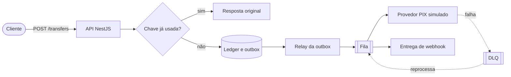
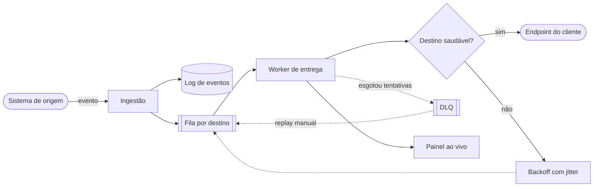
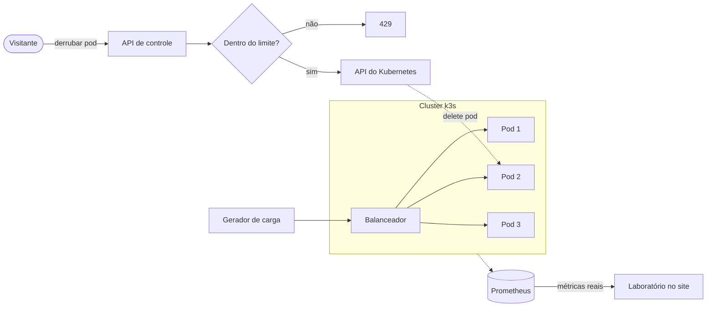
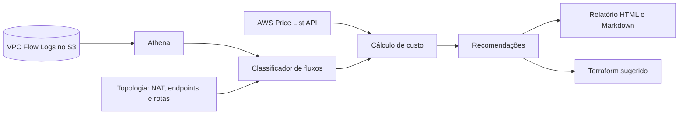
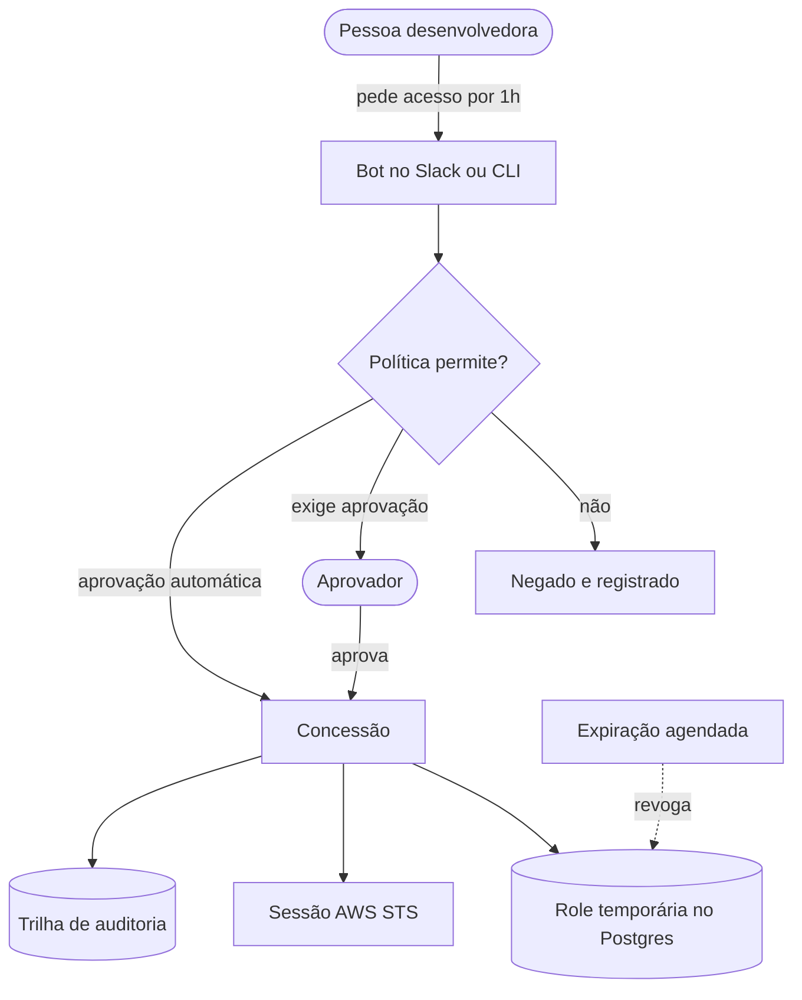
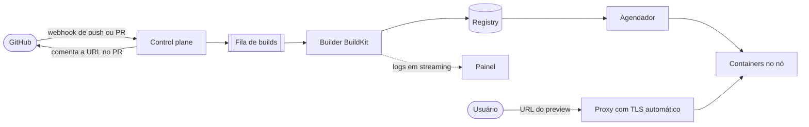
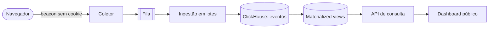
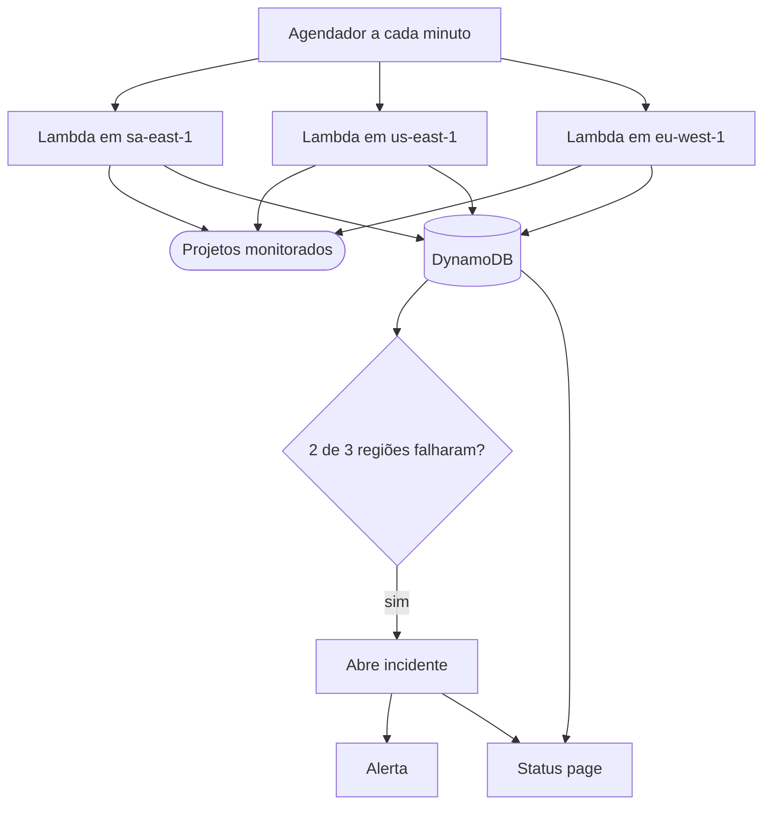
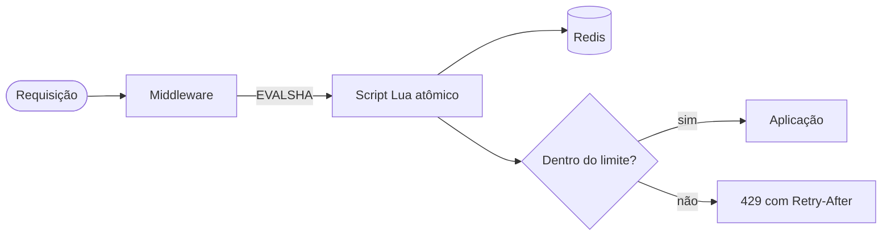
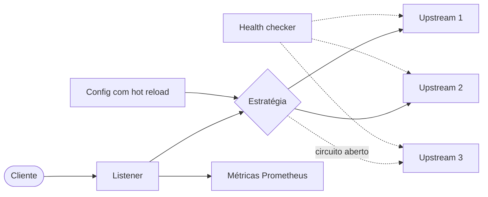

# Ideias de projetos para o portfólio

Dez projetos pensados para o seu perfil (backend sênior, AWS, plataforma e DevOps, com passagem por pagamentos e webhooks em alto volume). Cada um traz o escopo mínimo, o que o torna diferente de um tutorial, como virar uma peça interativa no site e um diagrama pronto para colar no painel.

## Onde o portfólio está hoje

O site tem dois estudos de caso reais (migração AWS na UTMify e a plataforma de inventário na Motorista PX) e um projeto marcado como `[Demo]`. Os dois reais são fortes, mas têm a mesma limitação: o código é das empresas, então quem visita precisa acreditar no texto.

O que falta são três coisas que só projetos próprios dão:

1. **Código que a pessoa pode abrir e ler.**
2. **Algo que ela pode usar ou quebrar** em menos de um minuto, sem cadastro.
3. **Números que você mesmo mediu**, com o script para reproduzir.

A lista abaixo foi montada para cobrir essas três lacunas.

## O que faz um projeto impressionar

Vale mais um projeto com todos os itens abaixo do que cinco sem eles.

- **Um problema difícil de verdade no centro.** Concorrência, falha parcial, consistência, custo. CRUD com autenticação não conta.
- **Uma prova, não uma afirmação.** "Não perde dinheiro sob concorrência" vem com o teste que dispara mil transferências simultâneas e confere o saldo.
- **Falha como funcionalidade.** Um botão que derruba uma dependência e mostra o sistema se recuperando vale mais que qualquer parágrafo sobre resiliência.
- **Decisões registradas.** Três ou quatro ADRs curtos ("por que Postgres e não DynamoDB aqui") mostram senioridade melhor que a lista de tecnologias.
- **Sobe com um comando.** `docker compose up` local e Terraform para a nuvem.
- **Uma seção "o que eu faria diferente".** Quem avalia sênior procura exatamente isso.

## Visão geral

Tamanho é uma estimativa minha para trabalho em noites e fins de semana: **P** = 1 a 2 semanas, **M** = 3 a 6 semanas, **G** = 2 a 3 meses.

| # | Projeto | O que prova | Tamanho | Liga com |
|---|---------|-------------|:-------:|----------|
| 1 | Ledger de pagamentos com PIX simulado | Consistência e concorrência com dinheiro | G | Trino |
| 2 | Relay de webhooks com entrega garantida | Filas, retentativas, isolamento de falhas | M | UTMify |
| 3 | Laboratório de caos real | Operação de cluster, deploy sem downtime | M | Seção "Laboratório" do site |
| 4 | Analisador de custo de rede na AWS | FinOps, redes, ferramenta open source | M | UTMify (redução de 86%) |
| 5 | Acesso just-in-time com auditoria | Segurança, governança, automação | M | Motorista PX (Teleport) |
| 6 | Mini-PaaS com preview por PR | Engenharia de plataforma de ponta a ponta | G | Motorista PX |
| 7 | Analytics próprio em ClickHouse | Pipeline de dados em volume | P–M | UTMify, ClickHouse |
| 8 | Status page com monitor multi-região | Serverless, SLO, confiabilidade | P | Todos os outros |
| 9 | Rate limiter distribuído com playground | Algoritmos, Redis, pacote npm publicado | P | Trino (força bruta no login) |
| 10 | Balanceador de carga do zero | Redes e fundamentos | M | Projeto 3 |

## Por onde começar

**Minha recomendação: 9, depois 2, depois 1.**

- O **9** é pequeno, termina rápido, publica um pacote no npm e já rende uma peça interativa nova para a home.
- O **2** conversa direto com o seu caso da UTMify e tem a demo mais fácil de entender: a pessoa manda um `curl` e vê a entrega acontecer.
- O **1** é o mais forte da lista para vagas de backend em fintech e substitui o projeto `[Demo]` que está no site hoje.

Em paralelo, o **8** pode entrar a qualquer momento: ele monitora os outros e gera os números de disponibilidade que vão nos estudos de caso.

Se a ideia for puxar o perfil para plataforma e SRE em vez de backend de produto, a ordem muda para **8, 4, 3 e 6**.

---

## 1. Ledger de pagamentos com PIX simulado

**Tamanho: G** (o escopo mínimo cabe em M)

API de carteira digital com contas, transferências e saque PIX contra um provedor falso, tudo em cima de um ledger de dupla entrada.

**Por que impressiona.** É o problema que separa quem fez CRUD de quem já lidou com dinheiro em sistema distribuído. Idempotência, corrida entre requisições e consistência com um terceiro que falha não têm atalho.

**Escopo mínimo**

- Ledger imutável de dupla entrada: o saldo é sempre a soma dos lançamentos, nunca uma coluna atualizada.
- `Idempotency-Key` obrigatória em toda escrita, devolvendo a resposta original em caso de repetição.
- Transferência com bloqueio correto (`SELECT ... FOR UPDATE` ou controle otimista) e ordem fixa de travas para evitar deadlock.
- Outbox transacional, fila e webhooks assinados com HMAC para o "lojista".
- Provedor PIX simulado com latência, timeout e taxa de erro configuráveis.

**O diferencial**

- Teste de concorrência que dispara milhares de transferências simultâneas e verifica o invariante: a soma de todos os saldos não muda.
- Testes baseados em propriedades (fast-check) gerando sequências aleatórias de operações.
- Rotina de conciliação que compara o ledger com o extrato do provedor falso e aponta divergências.
- Saga de estorno quando o provedor confirma depois do timeout.

**Demo interativa.** Sandbox público com chave de API descartável e um painel de caos: o visitante liga "provedor com 30% de timeout" e acompanha retentativas, estornos e a conciliação fechando.

**Números para medir.** Latência p50 e p99 em carga com k6, quantidade de operações sem violar o invariante, tempo até o sistema drenar a fila depois que o provedor volta.

**Stack.** NestJS, PostgreSQL, Redis, SQS ou BullMQ, k6, OpenTelemetry.

**Cuidado.** Regras de negócio, nomes de produtos e integrações da Trino ficam de fora. O domínio aqui é genérico e os dados são inventados.

---

## 2. Relay de webhooks com entrega garantida

**Tamanho: M**

Serviço que recebe eventos e garante a entrega em endpoints de terceiros. Svix e Hookdeck são produtos inteiros construídos em cima desse problema.

**Por que impressiona.** Você já operou isso com cerca de 100 mil webhooks por mês na UTMify. Aqui o mesmo conhecimento vira código aberto que qualquer pessoa pode ler e testar.

**Escopo mínimo**

- Ingestão que responde rápido e persiste antes de confirmar.
- Entrega com backoff exponencial e jitter, limite de tentativas e DLQ.
- Assinatura HMAC com timestamp para evitar replay.
- Replay manual de um evento ou de uma janela de tempo.
- Histórico de tentativas com status, duração e corpo da resposta.

**O diferencial**

- Isolamento por destino: um endpoint lento ou fora do ar não atrasa os outros. Prove com um benchmark em que 10% dos destinos estão caídos.
- Circuit breaker por destino, com retomada gradual.
- Ordenação opcional por chave (todos os eventos do mesmo pedido em ordem).
- Pacote npm pequeno para verificar a assinatura do lado de quem recebe.

**Demo interativa.** O visitante recebe uma URL temporária, dispara um `curl` e vê cada tentativa chegar ao vivo por SSE. Um botão "derrubar o destino" mostra o backoff e a DLQ em ação, e outro faz o replay.

**Números para medir.** Eventos por segundo por worker, latência de entrega p99, atraso dos destinos saudáveis enquanto os outros falham.

**Stack.** Node.js, TypeScript, PostgreSQL, SQS ou Redis Streams, SSE.

---

## 3. Laboratório de caos real

**Tamanho: M**

A seção "Derrube um servidor. Eu espero." do site hoje é uma simulação no navegador. Este projeto troca a simulação por um cluster de verdade.

**Por que impressiona.** Quase nenhum portfólio deixa o visitante matar um processo em produção. E a história é boa: "isso era uma simulação, agora é real".

**Escopo mínimo**

- Três réplicas de um serviço simples atrás de um balanceador, em k3s numa VPS pequena (ou ECS Fargate).
- Gerador de carga constante rodando ao lado.
- API de controle com uma única ação pública: derrubar um pod.
- Prometheus coletando latência, erros e réplicas saudáveis, e o site lendo esses dados no lugar do motor de simulação.

**O diferencial**

- Rolling update real disparado pelo visitante, alternando entre duas imagens.
- Placar público: quantas quedas os visitantes já causaram e o tempo médio de recuperação.
- A simulação atual continua como reserva quando o cluster estiver indisponível, com um aviso claro de qual modo está ativo.

**Cuidados.** É o projeto com mais superfície de abuso. Namespace isolado com quotas, limite global de uma queda por vez, rate limit por IP, nenhum segredo dentro do cluster e um teto de gasto configurado na conta.

**Números para medir.** Tempo médio de recuperação, taxa de erro durante a queda, requisições perdidas em um rolling update.

**Stack.** k3s ou ECS, Terraform, Prometheus, GitHub Actions, Node.js.

---

## 4. Analisador de custo de rede na AWS

**Tamanho: M**

CLI open source que lê os VPC Flow Logs e a topologia da conta e responde: quanto do tráfego que hoje passa pelo NAT Gateway poderia ir por VPC endpoint, ficar na mesma zona ou nem sair da VPC, e quanto isso economizaria.

**Por que impressiona.** A redução de 86% no custo de rede da UTMify vira uma ferramenta que qualquer pessoa roda na própria conta. Existem ferramentas genéricas de custo (Komiser, Cloud Custodian, Infracost); o diferencial aqui é o foco em tráfego de rede, que é onde a fatura costuma surpreender.

**Escopo mínimo**

- `npx` com credenciais somente de leitura e a policy IAM mínima documentada.
- Consulta aos Flow Logs via Athena.
- Classificação dos fluxos: NAT para serviços AWS, tráfego entre zonas, saída para a internet.
- Relatório em HTML e Markdown com os maiores ofensores e a economia estimada.

**O diferencial**

- Gera o Terraform do endpoint ou da rota sugerida.
- Preços lidos da AWS Price List API, não fixos no código.
- GitHub Action para rodar toda semana e abrir uma issue quando o custo sobe.

**Demo interativa.** Relatório de exemplo navegável com dados sintéticos e, no site, o fluxo "antes e depois" no explorador de diagramas.

**Números para medir.** Economia identificada em uma conta de teste montada com tráfego conhecido, comparando a estimativa da ferramenta com a fatura real.

**Stack.** TypeScript, AWS SDK, Athena, Terraform.

---

## 5. Acesso just-in-time com aprovação e auditoria

**Tamanho: M**

Alguém pede acesso ao banco de produção por uma hora, um aprovador confirma, o sistema cria a credencial temporária e a revoga sozinho. Tudo fica registrado.

**Por que impressiona.** É um problema real de toda empresa que cresce, e você já construiu APIs de permissão sobre o Teleport na Motorista PX. Mostra segurança e governança, que pouca gente de backend consegue demonstrar.

**Escopo mínimo**

- Pedido por CLI ou bot no Slack, com motivo e duração.
- Políticas em arquivo versionado: quem pode pedir o quê e quem aprova.
- Concessão no Postgres com role temporária (`VALID UNTIL`) e na AWS com sessão STS.
- Revogação automática no vencimento.
- Trilha de auditoria somente de inserção.

**O diferencial**

- Modo break-glass: acesso imediato sem aprovação, com alerta e justificativa obrigatória depois.
- Relatório de compliance: quem acessou o quê nos últimos 90 dias.
- Testes que provam que a credencial deixa de funcionar no vencimento, inclusive com conexões já abertas.

**Demo interativa.** Ambiente de demonstração com um banco de mentira: o visitante faz o pedido, aprova como outro papel e vê a contagem regressiva até a revogação.

**Stack.** NestJS, PostgreSQL, AWS STS e IAM, Slack API.

---

## 6. Mini-PaaS com ambiente de preview por PR

**Tamanho: G**

`git push` vira build, deploy e URL. Cada pull request ganha um ambiente próprio, destruído quando o PR fecha. Pense em uma versão pequena de Dokku ou Coolify, escrita por você.

**Por que impressiona.** É engenharia de plataforma de ponta a ponta: webhooks, build de imagens, orquestração, proxy, TLS e experiência de quem desenvolve. É também o maior projeto da lista, então o escopo mínimo precisa ser respeitado.

**Escopo mínimo**

- GitHub App que recebe push e eventos de PR.
- Build de imagem com BuildKit e logs em streaming.
- Deploy em um único nó (Docker ou k3s).
- Proxy reverso com TLS automático e subdomínio por ambiente.
- Comentário no PR com a URL e remoção do ambiente no fechamento.

**O diferencial**

- Rollback em um comando.
- Scale-to-zero para ambientes de preview ociosos.
- Limites de CPU e memória por projeto.
- Os outros projetos deste arquivo hospedados nela.

**Demo interativa.** Vídeo curto do fluxo completo e um repositório de exemplo em que qualquer PR aberto gera um ambiente.

**Números para medir.** Tempo do push até a URL responder, tempo de partida a frio de um ambiente adormecido.

**Stack.** Node.js ou Go, BuildKit, k3s, Caddy ou Traefik, PostgreSQL.

---

## 7. Analytics próprio do portfólio em ClickHouse

**Tamanho: P a M**

Coletor de eventos sem cookies, fila, ClickHouse e um dashboard público com os acessos do próprio site.

**Por que impressiona.** O portfólio passa a rodar em cima de algo que você construiu, e qualquer visitante vê o resultado. Também dá uso real ao ClickHouse que já aparece na sua stack.

**Escopo mínimo**

- Script de coleta leve, sem cookie e sem guardar IP.
- Ingestão em lotes a partir de uma fila.
- Tabela de eventos e materialized views para as consultas do dashboard.
- Página pública com visitas, páginas mais vistas, origem e campanhas UTM.

**O diferencial**

- Teste de escala com centenas de milhões de eventos sintéticos, rotulados como sintéticos, e os tempos de consulta publicados.
- Comparação honesta entre a consulta na tabela bruta e na materialized view.
- Nota curta sobre LGPD: o que é coletado, o que não é e por quê.

**Demo interativa.** O próprio dashboard, com filtros por período e origem.

**Stack.** Node.js, ClickHouse, SQS ou Redis Streams, Next.js.

---

## 8. Status page com monitor multi-região

**Tamanho: P**

Funções agendadas em três regiões checam os seus outros projetos, gravam o resultado e alimentam uma página de status com histórico de 90 dias.

**Por que impressiona.** É a cola da lista. Cada estudo de caso passa a ter um número de disponibilidade medido por você, e uma página de incidentes com postmortems reais mostra maturidade operacional.

**Escopo mínimo**

- Lambdas agendadas em três regiões, com checagem HTTP e de latência.
- Resultados no DynamoDB com TTL.
- Página de status estática, gerada a partir dos dados.
- Alerta por e-mail ou Telegram.

**O diferencial**

- Detecção por quórum: o incidente só abre quando duas de três regiões falham, o que elimina falso positivo de rede.
- SLO e error budget visíveis por serviço.
- Postmortem escrito para cada incidente, mesmo os pequenos.
- Infraestrutura inteira em Terraform, com custo mensal publicado.

**Stack.** AWS Lambda, EventBridge, DynamoDB, Terraform, Next.js.

---

## 9. Rate limiter distribuído com playground de algoritmos

**Tamanho: P**

Biblioteca npm com quatro algoritmos (janela fixa, janela deslizante, token bucket e GCRA) implementados em Redis com scripts Lua atômicos, mais middleware para NestJS e Express.

**Por que impressiona.** É pequeno, mas tem profundidade: atomicidade, relógio, justiça entre clientes. Um pacote publicado, com testes e documentação boa, é um sinal que pouca gente tem. E combina com a proteção contra força bruta que você fez na Trino.

**Escopo mínimo**

- Os quatro algoritmos atrás da mesma interface.
- Scripts Lua carregados com `EVALSHA`.
- Cabeçalhos `RateLimit-*` e `Retry-After`.
- Testes de concorrência contra um Redis real.

**O diferencial**

- **Playground no site:** o visitante clica para disparar requisições, ajusta limite e janela, e vê cada algoritmo aceitar ou negar lado a lado. É a peça interativa mais barata de construir desta lista.
- Benchmark de operações por segundo e de memória por chave.
- Documentação que explica quando cada algoritmo é a escolha errada.
- Comportamento definido para quando o Redis cai (fail-open ou fail-closed, configurável).

**Stack.** TypeScript, Redis, Lua, Vitest.

---

## 10. Balanceador de carga do zero

**Tamanho: M**

Proxy reverso HTTP escrito por você, com as mesmas peças que o laboratório do site hoje simula: estratégias de balanceamento, health checks e remoção de instâncias doentes.

**Por que impressiona.** Projetos "do zero" mostram fundamento. Depois de anos configurando ALB e Nginx, escrever um prova que você sabe o que acontece por baixo. Se quiser exibir uma segunda linguagem (Go ou Rust), este é o projeto certo para isso.

**Escopo mínimo**

- Round robin, least connections e pesos.
- Health checks ativos e detecção passiva de falha.
- Retentativa em outro upstream para requisições idempotentes.
- Configuração recarregada sem derrubar conexões.
- Métricas no formato Prometheus.

**O diferencial**

- Circuit breaker por upstream e orçamento de retentativas (para não amplificar uma falha).
- Encerramento gracioso com drenagem de conexões.
- Benchmark honesto contra Nginx e HAProxy. Ele vai perder, e a explicação do porquê é a parte mais interessante do README.
- Uso como o balanceador do projeto 3.

**Stack.** Node.js, Go ou Rust; wrk ou k6 para o benchmark.

---

## Checklist para cada repositório

- README que abre com o problema, não com a lista de tecnologias.
- Diagrama da arquitetura.
- Três ou quatro ADRs curtos em `docs/adr/`.
- `docker compose up` funcionando em uma máquina limpa.
- Terraform para subir na nuvem, com o custo mensal estimado.
- CI rodando lint, testes e build.
- Teste de carga versionado, com os números e o hardware usado.
- Demo no ar ou vídeo de até dois minutos.
- Seção "limitações e o que eu faria diferente".

## Como cadastrar no portfólio

Cada projeto vira um estudo de caso em `/admin/projetos`. O painel já tem um lugar para cada parte:

| No painel | O que colocar |
|-----------|---------------|
| Seções | Contexto, decisões, desafios, resultados e aprendizados. As decisões saem direto dos ADRs. |
| Diagramas | O bloco Mermaid deste arquivo. Todos começam com `flowchart`, então o site desenha o explorador interativo com simulação, em vez do diagrama estático. |
| Métricas | Os números que você mediu (p99, eventos por segundo, tempo de recuperação). |
| Endpoints | As rotas principais da API; o site gera o exemplo em `curl`. |
| Blocos de código | O trecho mais interessante: o script Lua, a transação do ledger, o cálculo de backoff. |
| Links | Repositório, demo, documentação e vídeo. |

Quando o primeiro projeto real for publicado, vale remover o `[Demo] API de pagamentos orientada a eventos`.

## Além dos projetos

Três coisas pequenas que somam bastante ao lado de qualquer item acima:

- **Contribuições em projetos que você já usa.** Um PR aceito no NestJS, no Prisma, no BullMQ ou no provider AWS do Terraform é verificável por qualquer pessoa.
- **Postmortems públicos.** Quebre um dos seus projetos de propósito e escreva o que aconteceu, como você descobriu e o que mudou.
- **Um artigo por projeto.** O aprendizado mais contraintuitivo de cada um, em texto curto. É o que as pessoas compartilham.
